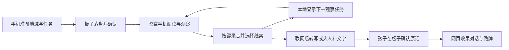

# 墨水屏接入

板卡已确认：**Waveshare ESP32-S3-ePaper-3.97**，800×480，QMI8658 六轴传感器、ES8311 音频、三向拨杆。不是触摸屏。

- 给现有 Qoder 工程合并：读 [QODER_HANDOFF.md](QODER_HANDOFF.md)。
- 独立 Arduino 3.2.0 应用：读 [firmware/README.md](firmware/README.md)。
- 代码：`firmware/include/MotionEngine.h` 与 `firmware/src/`。

## 已编码的循环

离线按孩子确认的线索分支，不声称板端AI已理解声音。六个节点为声音、飞行、落脚、取食、暂没遇见、其他发现；不确定的鸟名仍是猜想。

摆臂是另一条运动输入：校准 → 角速度往返脉冲 → 估算速度与书页对比 → 完成这一程 → 说出感受 → 收进路牌。没有距离传感器，不输出真实百米成绩。

本轮以手机网页兜底；硬件驱动与音频需真机验证。完整协议、恢复方法和已知限制见合并单。

最新速度映射、板端峰值与阿里云语音接入见 [增量合并说明](UPDATE_SPEED_ASR.md)。
